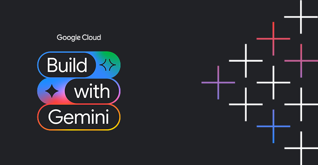

<div align="center">



# 🧭 Travel Concierge (智慧旅遊與秘境規劃師)

### An agent-first travel assistant built with Google Agent Development Kit (ADK), Agent Platform, and Gemini.

<p align="center">
  
</p>


</div>

---

## 🌟 Overview

**Travel Concierge** is an intelligent travel planning assistant designed to help travelers discover curated hidden gems, design tailor-made daily itineraries, retrieve real-time weather, look up nearby venues, and generate postcard-style imagery and cinematic destination preview videos.

It leverages Google Cloud's Agent Platform, Vertex AI Memory Bank, Firestore, Cloud Storage, and Gemini models to provide a personalized, multimodal travel planning experience.

---

## 🏗️ Architecture & Wired Google Cloud Services

The agent is built with Google Agent Development Kit (ADK) and integrates the following live services:

| Component / Layer | Google Cloud Service / Technology | Implementation Details |
|---|---|---|
| 🤖 **Reasoning Core** | **Gemini 3.8 Flash** (`gemini-3.8-flash`) | Coordinates user intent, tool calling, and structured itinerary creation. |
| 🧠 **Long-Term Memory** | **Vertex AI Memory Bank** (Agent Platform) | Uses `PreloadMemoryTool` and `add_session_to_memory` callback to remember traveler dietary restrictions, allergies, and style preferences across sessions. |
| 🗄️ **Structured Database** | **Cloud Firestore** | Stores curated hidden gems (`travel_destinations`) and user-created itineraries (`user_itineraries`). |
| 🖼️ **Asset Storage** | **Cloud Storage (GCS)** | Public storage bucket for hosting generated postcard images and short destination videos. |
| 🎨 **Image Generation** | **Gemini 3.1 Flash Lite Image** (`gemini-3.1-flash-lite-image`) | Generates scenic postcard-style images, saved directly to ADK Artifacts and GCS. |
| 🎬 **Video Generation** | **Gemini Omni Flash** (`gemini-omni-flash-preview`) | Generates short cinematic flyover preview videos using Google GenAI SDK Interactions API. |
| 🧪 **Code Execution Sandbox** | **Agent Platform Code Sandbox** | `AgentEngineSandboxCodeExecutor` safely executes Python code for budget calculations, currency conversions, and route time estimates. |
| 🪟 **Agent-to-UI (A2UI)** | **A2UI Schema v0.8 & Basic Catalog** | Emits rich cards, columns, rows, text, and images rendered natively in the UI instead of plain text. |
| 🌐 **Web Frontend** | **FastAPI Proxy + Chat UI on Cloud Run** | Lightweight asynchronous proxy communicating with the deployed agent via the Agent-to-Agent (A2A) protocol. |

---

## 🛠️ Implemented Tools & Capabilities

Based directly on [`app/agent.py`](travel-concierge/app/agent.py):

- **`search_destinations`**: Queries Firestore for curated destinations and secret spots filtered by city, country, tags (e.g. `nature`, `hiking`, `culture`), or budget.
- **`get_destination_details`**: Retrieves comprehensive information for a specific destination from Firestore.
- **`add_custom_destination`**: Allows travelers to contribute their own newly discovered secret spots into the Firestore collection.
- **`save_trip_itinerary`**: Persists finalized trip plans and schedules into Firestore (`user_itineraries`).
- **`get_weather`**: Fetches live weather conditions, apparent temperature, humidity, and wind speed using geocoding and the Open-Meteo API.
- **`geocode_address`**: Converts address or landmark queries into latitude and longitude coordinates using the Google Maps Geocoding API.
- **`find_nearby_places`**: Discovers nearby attractions, cafes, restaurants, or lodging around specific coordinates using Google Maps Places API.
- **`generate_destination_image`**: Generates aesthetic preview images with `gemini-3.1-flash-lite-image`, registers them as ADK artifacts via `tool_context.save_artifact`, and uploads to Cloud Storage.
- **`generate_destination_video`**: Generates cinematic destination videos with `gemini-omni-flash-preview` in the global region, registers them as ADK artifacts, and uploads to Cloud Storage.
- **`PreloadMemoryTool`**: Injects durable user facts (such as peanut or seafood allergies) into context before planning dining and activities.
- **`AgentEngineSandboxCodeExecutor`**: Executes Python code in a secure sandbox environment for budget formulas and itinerary pacing calculations.

> **Status of Planned Features:**
> - Multi-day route optimization graph visualization: *Planned, not yet implemented.*

---

## 📂 Project Structure

```text
├── assets/
│   ├── build-with-gemini-banner.png
│   └── demo.gif                     # Demo recording GIF
├── project_brief.md                 # Initial agent design brief
├── travel-concierge/
│   ├── app/
│   │   ├── agent.py                 # Core agent definition, instruction & tools
│   │   ├── a2ui_utils.py            # A2UI callback and data part processing
│   │   ├── app_utils/               # A2A protocol route setup
│   │   └── fast_api_app.py          # ADK FastAPI entrypoint
│   ├── frontend/                    # Lightweight FastAPI A2A proxy & chat UI
│   │   ├── main.py                  # Proxy backend forwarding requests over A2A
│   │   ├── static/                  # Vanilla chat interface & A2UI renderer
│   │   └── requirements.txt
│   ├── agents-cli-manifest.yaml     # Deployment metadata & manifest
│   ├── pyproject.toml               # Python dependencies
│   └── deployment_metadata.json     # Remote runtime IDs
└── demo_video.mp4                   # Full HD recorded demo video
```

---

## 🚀 Getting Started

### Prerequisites

- Python 3.13+
- [`uv`](https://docs.astral.sh/uv/) package manager
- Google Cloud SDK (`gcloud`) authenticated with a project having Vertex AI, Firestore, and Cloud Storage APIs enabled

### 1. Installation

Clone this repository and install dependencies in the `travel-concierge` directory:

```bash
cd travel-concierge
uv sync
```

### 2. Environment Configuration

Ensure Google Cloud application default credentials are configured:

```bash
gcloud auth application-default login
```

If using Google Maps features, set your API key:

```bash
export GOOGLE_MAPS_API_KEY="<YOUR_GOOGLE_MAPS_API_KEY>"
```

### 3. Running Locally with ADK Web UI

Start the local ADK developer playground with live reloading and Memory Bank support:

```bash
uv run adk web . --port 8080 --reload_agents --memory_service_uri=agentengine://<MEMORY_BANK_AGENT_ENGINE_ID>
```

Open your browser to the local server port to test interactive chat, inspect A2UI cards, view generated artifacts, and inspect runtime traces.

### 4. Running the Chat Frontend Locally

Navigate to the `frontend/` directory and start the FastAPI proxy:

```bash
cd frontend
export AGENT_ENGINE_RESOURCE_NAME="projects/<PROJECT_ID>/locations/<REGION>/reasoningEngines/<ENGINE_ID>"
export AGENT_DIRECTORY="app"
uv run uvicorn main:app --host 0.0.0.0 --port 8081 --reload
```

---

## 📄 License

Licensed under the Apache License, Version 2.0.
